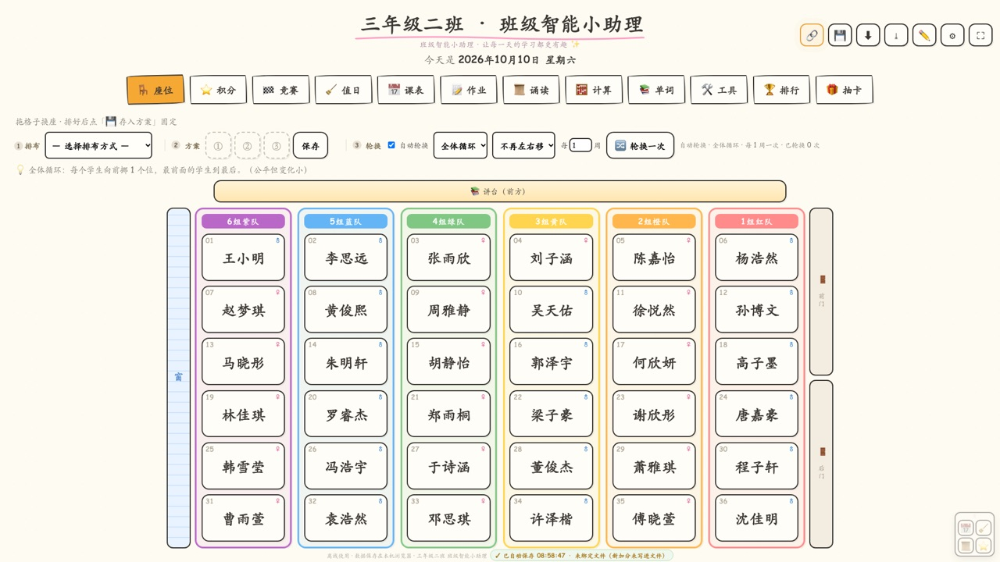
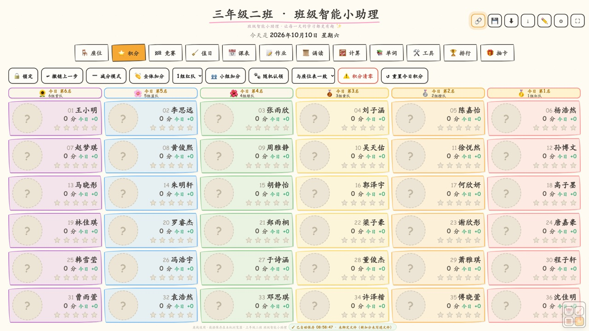
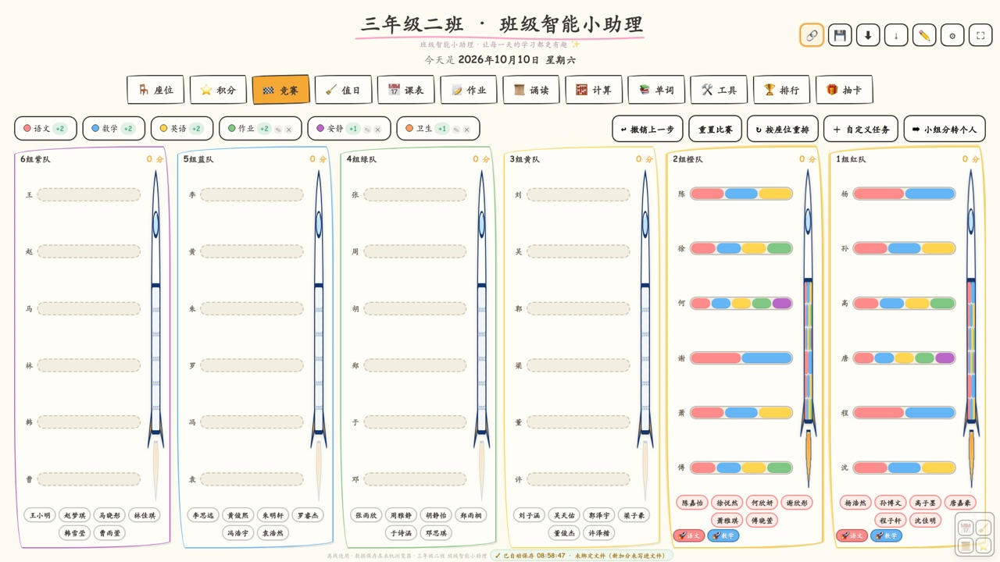
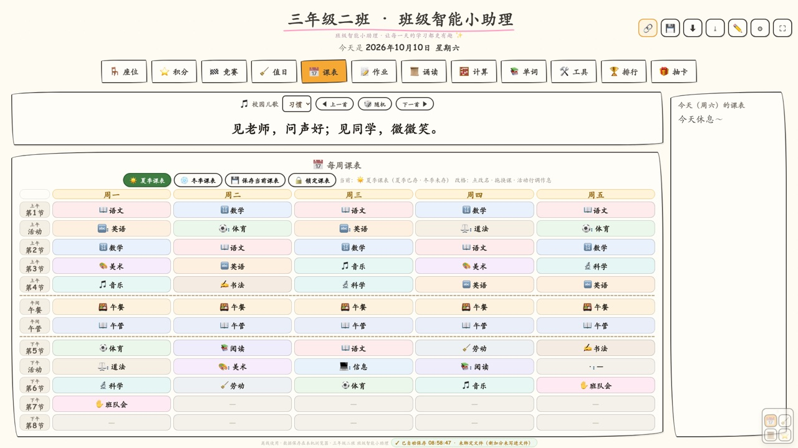

# Classroom Management Workbench Generator

<p align="center">
  
</p>

> A **single-file, offline classroom management workbench** generator for homeroom teachers.
> Twelve teaching modules in one HTML page — double-click to run, no internet, data stays on your own computer, built for touch screens in classrooms.

<p align="center">
  
  
</p>
<p align="center">
  
  
</p>

## Modules

| Page | What it does |
|---|---|
| 🪑 Seating | Drag to swap seats, 3 saveable plans, weekly auto-rotation, boy-girl alternation |
| ⭐ Points | Add/deduct points (can go negative), level badges, random animal avatars |
| 🏁 Team contest | Auto-grouped by seating column, tap to complete tasks, launch a rocket when a team finishes 🚀 |
| 🧹 Duty roster | Rotating duty posts, class posts, teacher adjustments |
| 📅 Timetable | Summer / winter schedules, paste-a-table import, school rhymes |
| 📝 Homework | Four subject quadrants, per-subject font size (readable from 5 m away) |
| 📜 Recitation | Built-in poem library, today's reading, random pick |
| 🧮 Math drills | Mental / vertical / mixed practice, custom question bank, exact division only |
| 📚 Vocabulary | Built-in word bank, spaced-repetition review, colour-coded flashcards |
| 🛠 Tools | Random picker, countdown timer |
| 🏆 Ranking | Today / yesterday / monthly leaderboards |
| 🎁 Reward cards | Points-to-perks card draw with album and pity system |

**The interface is available in Chinese and English** — switch it in ⚙ Settings → 🌐 Interface language.
(Student names, poems, rhymes and word data are never translated.)

## Install (pick whichever is easiest)

| Route | Best for | How |
|---|---|---|
| 🌐 **Web generator** (zero install) | Teachers who don't want to install anything | Open the **[online version](https://seahp.github.io/class-management-workbench/)** or `docs/index.html` → fill in class name / student list / group count → Generate → download. Runs entirely in the browser |
| 📄 **Ready-to-use file** (simplest) | Teachers who just want it working now | Download [`examples/班级小助手-通用版.html`](examples/班级小助手-通用版.html) → double-click → ⚙ Settings → ③ paste your student list |
| 🤖 **AI assistant** | Teachers who have an AI assistant | `skillhub install class-management-workbench --namespace user_1db801dd` · [SkillHub page](https://skillhub.cn/skills/class-management-workbench) → ask the AI for a workbench |
| 🧑‍💻 **Source / development** | Developers | `git clone https://github.com/seahp/class-management-workbench.git` and use `scripts/customize.py` |

> All four routes produce identical files — the web generator and the Python script are verified to be **byte-for-byte identical** in output.

## Quick start

```bash
git clone https://github.com/seahp/class-management-workbench.git
cd class-management-workbench

# roster.txt: one student per line, e.g. "Alice Smith F" (F/M optional for gender-aware seating)
python3 scripts/customize.py \
  --class-name "Grade 3 Class B" \
  --names-file roster.txt \
  --cols 6 \
  --out ~/Desktop/class-workbench.html
```

Open the generated file by double-clicking it — that's it.

## ⚠️ About data storage (read this first)

- Data is stored **in the local browser** (localStorage) plus, optionally, written back into the HTML file itself.
- **Nothing is uploaded anywhere.** The program makes no network requests at all, which is why it works on offline classroom PCs.
- To move to another computer: **⬇ Export all data** (.json) or **📄 Export transfer pack**, then import on the new machine.
- **If the classroom PC has a restore card (Deep Freeze, system restore):** click **⚙ Settings → ④ → 🔗 Bind program file** once per boot. Data is then written into the HTML file, and tomorrow you just double-click it.
- Browsers require you to **re-confirm file-write permission each time a page is reloaded** — this is a browser security rule, not a bug. The app shows a one-tap **🔓 Restore write access** button when needed.

## FAQ

The app has a built-in **❓ Having trouble?** panel (top-right corner) with 12 plain-language answers covering
data storage, moving computers, restore cards, timetable switching and more.
A longer version lives in [`references/faq-for-teachers.md`](references/faq-for-teachers.md).

**I need to switch to PowerPoint — how do I hide this quickly?**
Tap **⤓** at the top: it saves, exits fullscreen and shrinks the window. Restore from the taskbar.

**Does it need internet?**
No. Zero external dependencies — fully usable offline.

**Will it look right on a classroom touch screen?**
Fonts scale with screen width (×1.8 above 2400 px), and homework font size is adjustable per subject.

## Repository layout

```
├── docs/index.html           # Web generator (GitHub Pages source)
├── SKILL.md                  # AI skill definition (full usage & customisation guide)
├── scripts/
│   ├── customize.py          # One-command generation: class name / roster / groups / timetable
│   ├── build_template.py     # Maintainer: rebuild the sanitised template
│   ├── add_i18n.py           # Maintainer: inject the Chinese/English switcher
│   ├── build_web_generator.py# Maintainer: build the single-file web generator
│   └── i18n-en.json          # UI translation dictionary (869 entries)
├── templates/                # Sanitised template + ready-to-use file + web generator
├── examples/                 # Generated examples (fictional classes)
├── references/               # Module notes / iteration rules / verification checklist / teacher FAQ
└── screenshots/
```

## Changelog

- **v2.2.0** — Easier onboarding: added a **web generator** (zero install) and a **ready-to-use file**; built-in **❓ Having trouble?** panel; fixed timetable-season switching resetting custom timetables, and un-recoverable file-write permission failures
- **v2.1.1** — Fixed generated files showing the default class name in the header
- **v2.1.0** — Fixed Markdown-table timetable import; card-draw buttons never bound; high-score crash
- **v2.0.0** — Animal avatar level system (12 watercolour pets, star-based levelling, unlimited Lv), 1.8× scaling for 3480 px classroom displays

## License

[MIT](LICENSE)

---

_Author: 粉笔与代码 ("Chalk and Code") — a small tool written by a teacher, for teachers._
